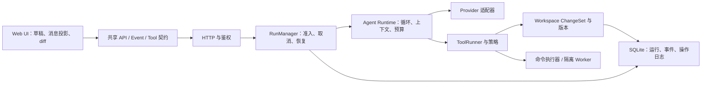

# Perseus Studio：架构对标与项目总监评估

评估日期：2026-10-20。对象为当前工作树，包括本轮已经修复的编辑链路；不是只评估原始 `fa641a6`。本报告的改进项属于建议，未将其视为已经实施的能力。

## 1. 总监判断

**这是一个具备较完整产品外壳、运行内核仍需收敛的早期 Agent 工作台。可以继续建设，现阶段不应按成熟多租户 Agent 平台承诺稳定性。**

代码不是毫无章法：React 组件、hooks、Go API/store/workspace 已有边界；已有事件序号、持久化检查点、工具执行账本、操作去重、重试、上下文压缩、完成校验和浏览器回归。这些值得保留。

主要问题是：文件拆得较细，但状态和协议仍有较多隐式约定；运行恢复与文件副作用尚未形成完整闭环；测试通过还不足以证明复杂任务可靠。此前“测试通过但模型拿不到编辑工具”，就是契约验证不足的直接证据。

建议下一阶段优先建设“修改可信、失败可恢复、结果可验证”的单机工作台，再扩展多用户和插件生态。继续增加模型、动效、任务类型，可能放大现有复杂度。

## 2. 范围与证据边界

- 本地检查：架构约定、前后端主链路、任务生命周期、工具执行、文件验证、CI 和备份方案。
- 外部对标：直接读取 OpenHands、Cline、OpenCode、Aider 官方仓库的 README 及相关源码/文档，固定提交列于文末。它们是代表性成熟项目，并非按 GitHub 星数生成的“前四排名”。
- 本轮没有启动付费模型测试，也没有改动或重启供用户手动测试的服务。
- 已有实测证据：后端测试、126 项前端单测、13 项本地浏览器回归、两款 Grok 的真实三文件编辑。它们证明特定流程可用，不代表长期稳定性、并发容量或复杂代码任务成功率。
- 下文区分“静态确认的设计现状”和“需要故障注入验证的风险”。没有做覆盖率、认知复杂度或负载基准，不给出伪精确的综合质量分。

## 3. 与成熟项目比较，应学什么

| 参照项目 | 已核查的机制 | Perseus 当前情况 | 应引入的最小能力 |
|---|---|---|---|
| OpenHands | 控制界面与 Agent Server 分工，支持独立会话容器；官方明确宿主执行与容器执行的区别 | 文件服务按用户区分，但命令在服务进程所在环境执行 | 定义执行器接口；公开多用户场景使用隔离 worker；单机先做好任务限额与完整取消 |
| Cline | 工具审批、文件 diff、检查点恢复；恢复源码包含工作树保护事务 | 有工具范围校验与运行检查点，缺少完整的用户文件变更审查/撤销闭环 | 每轮生成变更集、展示 diff、保留原文版本、允许按轮撤销；策略支持自动允许/询问/拒绝 |
| OpenCode | 独立权限模块、共享事件 schema、会话模块与版本化数据库迁移 | 有持久事件和适配器，但前端 JS 与 Go JSON 字段靠人工对齐；多处维护工具信息 | 对事件与工具建立单一契约、校验和生成；前端逐步引入类型；运行生命周期从 HTTP 层迁出 |
| Aider | Git 集成、修改后的 lint/test 反馈，以及按 token 预算挑选的 repository map | 主要是文件读取、搜索和内容验证；代码语义诊断与项目级上下文较弱 | 先接项目配置的 lint/test 与变更后验证，再按需求增加符号索引和仓库摘要 |

这些机制适用于不同产品形态，不能把每个项目的全部功能清单合并成 Perseus 的需求。Git 检查点也不等于文件系统事务；工具审批更不等于操作系统沙箱。

## 4. 代码是否整洁：有分层，但存在分散的耦合

### 4.1 规模快照

按本地源码统计，不含依赖、构建产物和测试；行数包括空行、注释及末尾换行，属于规模指标：

| 区域 | 规模 |
|---|---:|
| 前端生产 JS/JSX | 111 文件，约 16,056 行 |
| `src/hooks` | 48 文件 |
| `backend/internal` 生产 Go | 198 文件，约 36,076 行 |
| `backend/internal/ai` | 110 文件，约 20,143 行 |
| `useChatState` 内部状态 | 17 个 `useState`、10 个 `useRef` |

项目规模本身不异常，文件数量也不是缺陷。问题是：拆分之后，能否单独理解、替换和测试一个模块。

### 4.2 前端：业务状态分散，跨模块传递过多 setter/ref

证据：`src/hooks/useChatState.js` 组装多组 action factory，反复传递会话、发送、恢复、steer 的 setter/ref；`chatRunStream.js` 同时承担连接管理、轮询回退、消息合并、进度展示和多个状态更新。

影响：新增一个“暂停/恢复/排队”状态时，需要推理多个布尔值、异步请求和 ref 的组合。拆成更多文件不会自动减少非法状态与竞态。

建议：

1. 先定义聊天运行状态及合法转换，使用 reducer 管理业务状态；DOM ref、AbortController 等仍保留为运行资源。
2. 将连接资源、后端快照、消息投影、输入草稿分开管理；组件派发意图，减少直接修改彼此状态。
3. 对重复事件、乱序事件、断线重连、会话切换建立可重放事件夹具。
4. 先让 `api/client`、事件 payload、工具结果具备类型，再逐步迁移相关 hooks。无需一次重写全部 JSX，也无需为此引入多个状态库。

验收：同一组事件重放得到相同业务状态；切换会话后旧请求不能修改新会话；取消/恢复/排队的非法组合可被测试明确拒绝。

### 4.3 后端：同一个 Go 包内的分文件，不构成强制架构边界

证据：`ai` 包同时容纳供应商适配、上下文、运行循环、工具 schema、具体文件工具、任务、网络访问、诊断等；大量方法挂在 `Service` 上。现有 provider 接口和 registry 已有基础，但仍能跨文件直接访问同包内部细节。

建议：先画清依赖方向，再在功能触及处逐步抽出 `protocol`、`provider`、`runtime`、`tools` 的最小接口；文件实际读写继续由 `workspace` 管理，数据库仍由 `store` 管理。以减少跨职责依赖为目标，不按行数机械搬文件。

验收：用内存事件仓库、模拟供应商和模拟工具运行器即可执行 runtime 测试；替换供应商无需接入 HTTP handler 或真实用户目录。必要时增加包依赖规则，防止 provider 反向依赖 API。

### 4.4 工具契约仍有多份事实来源

证据：`tool_manifest.go` 维护可见性和元数据，`tool_schemas_common.go` 分协议选择 schema，`tool_registry.go` 再按名称路由执行；提示、恢复和前端识别还需同步。先前编辑工具故障正是这些约定分离造成的。

建议：建立统一 `ToolSpec`，包含名称、入参 schema、执行器、风险类型、可见性、结果类型；由它生成两种协议的声明。保留独立策略与执行器职责，统一的是契约来源，不是把全部实现塞进一个文件。

验收：每个可见工具都能找到执行器和合法 schema；两协议暴露的业务参数一致；全部写工具返回统一的逐路径变更集。旧工具别名通过显式兼容适配层处理。

### 4.5 类型与结构门禁需要升级

Go 核心大量使用 `map[string]any`，前端为未启用类型检查的 JS，事件 payload 经多次 JSON 转换和字符串判断。供应商边界使用动态对象合理，内部状态和业务结果则适合强类型。

450 行门禁可以提醒文件增长，但不能判断模块是否内聚，也不能证明协议正确。历史健康表里的 9.5/9.8 属于内部结构评分，不能当成生产质量结论。

建议保留现有行数提醒，加入契约一致性、静态类型、关键边界 lint、回归行为和运行可靠性证据；用“通过/部分具备/未验证”替代缺乏外部校准的总分。

## 5. 稳定性差距与优先级

### P0：运行副作用恢复

**静态确认：** `tools_executor.go` 依次执行 `StartToolCall → executeTool → CompleteToolCall`，运行内存/检查点另行记录已应用操作。文件写入与 SQLite 账本之间没有跨资源原子提交。

**待故障注入验证：** 文件落盘后、账本或检查点落盘前进程退出，恢复时可能不知道动作是否已执行；尤其不能安全地盲目重试命令、追加和外部操作。

方案：为执行意图分配持久 operation ID，记录准备状态、预期版本和逐文件前后哈希；恢复时按实际文件状态核对。文件变更可按条件重放，无法证明幂等的命令应进入 `outcome_unknown` 并要求核验。目标是可判定的恢复，不承诺任意工具的 exactly-once。

验收：在写入前、写入后、账本完成前分别强制退出；重启后不重复追加、不丢用户内容，未知结果被显式标记。

### P0/P1：运行生命周期与调度收敛

**静态确认：** 前台聊天由 API 启 goroutine，运行 context 来自 `context.Background()`，取消句柄位于进程内；后台任务另由 `tasks.Manager` 管理。启动时只将更新时间超过两分钟的 queued/running 标记为可恢复失败。

**待故障注入验证：** 快速重启时近期任务可能留在 running/queued；HTTP 停机与脱离请求的 Agent goroutine 不共享完整生命周期；前台运行并发缺少统一准入调度。

方案：建立应用级 RunManager，统一聊天和后台执行的准入、取消、停机等待、启动核对。先采用单实例 SQLite 调度，增加实例/启动标识；只有确实需要多执行实例时再引入租约、心跳和 fencing，避免过早堆分布式设施。

验收：运行中重启后没有永久假运行状态；取消后子进程树不再运行；同时提交超过限额的任务会排队；服务退出能在明确时间内收敛。

### P0（公开多租户）/P1（可信本地）：执行隔离与策略

**静态确认：** 用户目录隔离、角色与引用范围校验已存在，shell 仍可访问宿主环境；Dockerfile 未指定非 root 用户。

方案：可信本地先提供清楚的自动执行策略、时限、资源限额和目录限制；公开多用户必须使用隔离 worker，只挂载当前工作区，控制用户、网络、资源与进程树。高风险命令策略是可配置能力，不能让每次普通文件编辑都打断用户。

验收：跨用户文件、宿主敏感目录不可访问；超时与取消清理所有子进程；执行环境拿不到平台数据库与供应商凭证。

### P1：文件变更的可信度和可撤销性

**静态确认：** 已有 CAS 保存、版本/哈希和补丁回滚基础；多文件补丁失败时是尽力回滚。部分回滚错误被忽略。`tools_verify_workspace.go` 的内容验证主要检查主路径，部分 patch 分支会因存在 changed_paths 就接受“verified”。

方案：所有写工具返回统一 `ChangeSet`，每条写入、删除、移动都有前后状态；逐条验证，区分内容、文件系统结果和代码质量验证。将回滚失败/部分完成返回给用户。基于现有版本记录或私有 Git ref 增加按轮 diff 和撤销，恢复前先保护用户后续修改。

验收：第二个文件验证失败时任务不会呈现全部成功；撤销 Agent 修改不会覆盖用户随后输入；改、建、删、移动均可追溯。

### P1：从“写进去了”升级到“代码可用”

内容写入成功不证明代码能编译或通过测试。当前编辑器主要使用 textarea，未形成成熟代码诊断、diff 和测试结果闭环；仓库级上下文主要依赖路径、搜索、读取和摘要。

方案：为项目配置 lint/build/test 命令与超时，按改动范围执行并记录退出码；失败可交给 Agent 修复，但限制循环和费用。接入成熟编辑器组件以提供语法、搜索和 diff；LSP 与符号索引在核心可靠后推进。先解决可靠的项目诊断，不急着引入向量库。

验收：语法错误、测试失败、超时分别可见；最终答复区分“文件已写入”和“验证已通过”。

### P1：测试从功能门禁扩展为故障门禁

已具备的单测与 E2E 是良好起点。CI 当前以 Linux 单环境的常规 Go 测试、前端检查和 E2E 为主，缺少常设的并发检测、故障注入与跨平台取消验证。

建议补充：

- 供应商契约夹具：多 system、空响应、畸形/截断 SSE、分片工具参数、429、超时、普通 JSON 回退。默认本地离线运行；在线测试显式启用并限额。
- 故障矩阵：断线/重连/重复事件、SQLite 锁定/写失败、磁盘写失败、写后崩溃、快速重启、取消子进程树、人工与 Agent 并发编辑。
- Linux `go test -race`，补丁/路径/parser fuzz；Windows/Linux 运行关键文件和进程测试，避免只在一个平台宣布兼容。
- 固定任务集评估真实编辑结果：单文件、多文件重构、重命名、依赖更新、测试修复。报告成功率、修复次数、费用和耗时，不能只统计“模型说完成”。

验收：新增缺陷有稳定失败的回归；关键故障场景在 CI 中自动复现；付费 eval 与 PR 默认测试分离。

### P1/P2：运行观测、数据生命周期与发布

**静态确认：** 已有诊断 ID、工具日志和使用量记录；`/api/health` 主要返回静态存活信息；数据库迁移散落于多个 store 的 Migrate 方法；备份文档采用停服复制。未发现完整指标/SLO、版本化迁移链及常设恢复演练。

方案：

- 区分 liveness/readiness，后者检查数据库和执行器；统一 run/operation/provider request 关联标识及错误分类。
- 先统计运行成功、工具失败、首响应、排队时间、重试、恢复、账本写失败和资源占用；按是否含付费供应商、用户取消分类。
- 对供应商、用户和工作区设并发/费用/时长预算；新增日志脱敏、事件保留和清理规则。
- 迁移增加版本号、升级前备份与恢复测试；发布构建与已通过的源码/依赖版本绑定；建立小范围试用与回滚演练。

验收：能通过一个 run ID 解释失败发生在哪一层；依赖/存储不可用不呈现“全部健康”；备份在新目录恢复后能验证用户文件与数据库一致。

## 6. 推荐的目标边界

这是逻辑边界图，不要求每个框都部署成微服务。保留 React、Go、SQLite 和单容器启动的便利。先把单进程做可靠，隔离执行器可以按部署需求独立运行。

## 7. 分阶段实施与交付门槛

以下为工作包顺序，不是未经排期的交付日期。完整改造涉及存储、执行和 UI，不应作为一次大 PR 交付。

| 阶段 | 交付物 | 进入下一阶段的门槛 |
|---|---|---|
| A：稳定性基线 | 故障夹具、错误分类、运行观测；记录当前任务成功率 | 已有 13 项回归和两款模型场景保持可用；关键故障可重复 |
| B：运行恢复 | RunManager、启动核对、持久 operation 意图、未知结果处理、完整取消 | 快速重启和写后崩溃均不假成功、不盲目重复副作用 |
| C：可信变更 | ChangeSet、逐路径验证、diff、按轮撤销、回滚失败展示 | 改/建/删/移动可追踪；撤销保护后续用户编辑 |
| D：契约和状态 | 统一 ToolSpec、事件 schema、生成类型、聊天 reducer；渐进提取后端边界 | schema/执行器自动一致；事件重放结果确定；旧客户端兼容明确 |
| E：执行治理 | 隔离 worker、策略、资源/并发/费用限额 | 多用户场景隔离测试通过；取消不遗留子进程 |
| F：代码能力与发布 | lint/test 闭环、编辑器诊断、任务评估集、迁移/备份/回滚演练 | 测得任务结果与耗时/费用；发布可复现并能恢复 |

如果计划立即对不可信用户开放，E 的隔离部分必须提前到上线前。其余情况下优先 B、C；D 随改动逐步推进，避免把全量 TypeScript/包拆分变成阻塞业务的前置工程。

## 8. 先不做什么

- 不因文件多就全量重写，也不因 Go 包大就按前缀机械改成十几个包。
- 不为了“成熟”直接引入 Kubernetes、Redis、Kafka、微服务；单机 SQLite 不是当前主要瓶颈的证据。
- 不优先叠加多 Agent、更多供应商和复杂插件；先确保单 Agent 的编辑、取消、恢复可靠。
- 不把提示词补丁或域名/模型名特判当作长期兼容架构；已修复的 Grok 规则应沉淀为能力配置及契约样本。
- 不把文件存在、工具执行成功或模型声称完成当作代码质量验收。

## 9. 研究来源

外部机制依据截至本次读取的固定提交；未以其营销描述推导未经实测的故障率，也未运行它们的完整产品基准。

- [OpenHands README：宿主执行、单/多 Docker sandbox](https://github.com/OpenHands/OpenHands/blob/8d39305538c1d17a30cbe477e57a0e18fcee7d95/README.md)；[架构职责](https://github.com/OpenHands/OpenHands/blob/8d39305538c1d17a30cbe477e57a0e18fcee7d95/docs/architecture.md)。
- [Cline README：diff、检查点、诊断](https://github.com/cline/cline/blob/41e75efc53e7abbcb76564b89e6de57f78659b33/README.md)；[工具审批](https://github.com/cline/cline/blob/41e75efc53e7abbcb76564b89e6de57f78659b33/sdk/packages/core/src/runtime/tools/tool-approval.ts)；[工作树检查点恢复](https://github.com/cline/cline/blob/41e75efc53e7abbcb76564b89e6de57f78659b33/sdk/packages/core/src/session/checkpoint-restore.ts)。
- [OpenCode 权限模块](https://github.com/anomalyco/opencode/blob/cb07c555d4d1ca34430b7857b52f104c3d95e09e/packages/core/src/permission.ts)；[共享会话事件 schema 入口](https://github.com/anomalyco/opencode/blob/cb07c555d4d1ca34430b7857b52f104c3d95e09e/packages/core/src/session/event.ts)；该提交的 `packages/core/src/database/migration`。
- [Aider Git 集成说明](https://github.com/Aider-AI/aider/blob/5dc9490bb35f9729ef2c95d00a19ccd30c26339c/README.md)；[lint/test 闭环](https://github.com/Aider-AI/aider/blob/5dc9490bb35f9729ef2c95d00a19ccd30c26339c/aider/website/docs/usage/lint-test.md)；[repository map](https://github.com/Aider-AI/aider/blob/5dc9490bb35f9729ef2c95d00a19ccd30c26339c/aider/website/docs/repomap.md)。

本地量化与来源快照：`_local_artifacts/director-research/`。已有修复和实际测试记录见 [PROJECT_DIAGNOSIS.md](PROJECT_DIAGNOSIS.md)。
